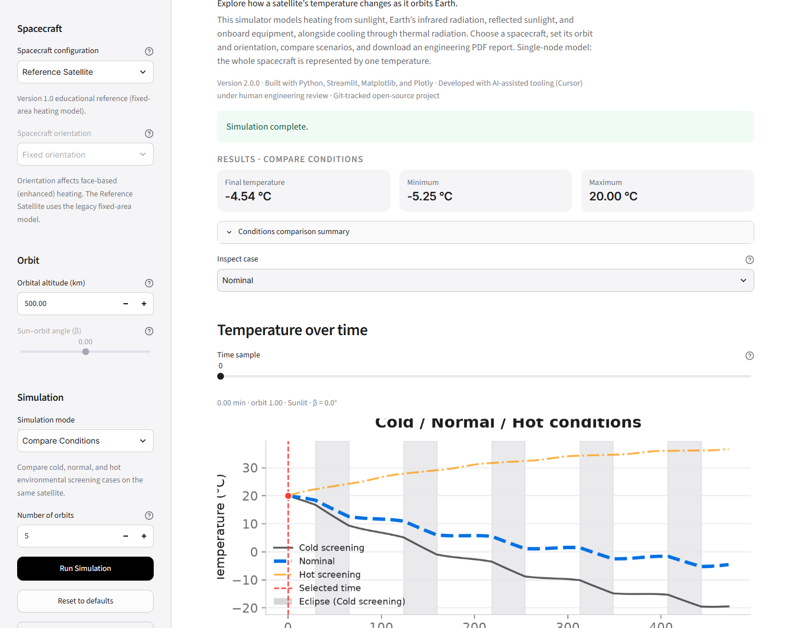
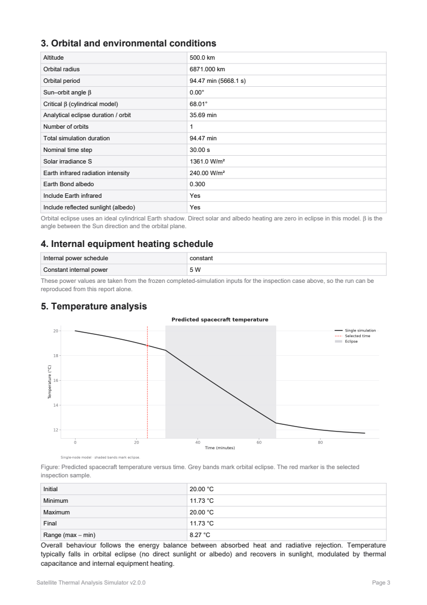

# Satellite Thermal Analysis

Single-node thermal analysis of a spacecraft in low Earth orbit (LEO), with an
interactive Streamlit simulator, comparison modes, and downloadable PDF
engineering reports.

**Version 2.0** — educational engineering software with verified numerics.
Not flight-qualified thermal analysis.

## Live application

Use the simulator in a browser (no local Python install):

**https://satellite-thermal-analysis.streamlit.app**

Hosted on Streamlit Community Cloud. The public site may still show an older
deploy until Version 2.0 is published there — run locally for the latest V2
features (PDF reports, simplified sidebar, enhanced thermal options).

```bash
python -m pip install -r requirements.txt
python -m streamlit run app.py
```

Defaults are ready in the sidebar — click **Run Simulation**.


---

## What it does

The simulator predicts how a satellite’s temperature changes as it orbits Earth.
It models:

- Direct sunlight (zero during orbital eclipse)
- Earth infrared radiation
- Reflected sunlight (albedo)
- Internal equipment heating (constant or scheduled)
- Cooling by thermal radiation to space

You can explore spacecraft configurations, orbits, orientations, thermal
screening conditions, and comparison studies, then download a multi-page
**engineering PDF report** for the completed run.


---

## Version 2.0 features

- Variable orbital beta angle and generalized eclipse geometry
- Legacy fixed-area model (V1 reference) and enhanced face-based solar heating
- Prescribed spacecraft orientations: fixed, Earth-facing, Sun-facing
- Time-dependent internal equipment heating with event-aware integration
- Hot / Normal / Cold educational thermal screening presets
- Reference Satellite, 1U / 3U CubeSat-inspired, and custom spacecraft options
- Simulation modes: Single, Compare Configurations, Compare Heat Sources, Compare Conditions
- Interactive 3D orbital view synchronized with predicted spacecraft temperature
- Automatic PDF engineering report from the completed simulation



---

## Physical model (summary)

```text
m · cp · dT/dt = Q_solar + Q_earth_ir + Q_albedo + Q_internal − Q_radiated
```

Legacy mode uses fixed effective areas. Enhanced mode sums face solar absorption
and face radiation for a rectangular bus. Earth IR and albedo remain
effective-area loads. Time integration is explicit Euler. Full equations:
[`docs/MODEL.md`](docs/MODEL.md).

---

## Simulation modes

| Mode | Purpose |
| --- | --- |
| Single Simulation | One configured run |
| Compare Configurations | Your settings vs repository reference defaults |
| Compare Heat Sources | Sunlight only → +Earth IR → +albedo |
| Compare Conditions | Cold / Normal / Hot screening overlays |

---

## PDF engineering report

After a successful run, open **Export → Prepare Engineering Report (PDF)**.
The report is built from the **completed simulation** (frozen inputs — not live
sidebar edits) and includes:

- Cover page and executive summary
- Spacecraft, orbit, and internal-power schedule tables (full reproducibility)
- Predicted temperature history
- 3D orbital snapshot at the selected time sample
- Heat-flow breakdown
- Mode-specific comparison tables (overall deltas are Modified − Reference)
- Numerical method notes, limitations, and references



Requires `reportlab` and `kaleido` (listed in `requirements.txt`). Plotly’s
static image export may need a Chromium runtime in some environments — see
[`docs/PDF_REPORT.md`](docs/PDF_REPORT.md).

---

## Install, run, and test

```bash
python -m pip install -r requirements.txt
python -m streamlit run app.py
python -m unittest discover -s tests -v
```

Optional CLI studies (repository root):

```bash
python scripts/run_phase1.py
python scripts/run_phase2.py
python scripts/run_phase3a.py
python scripts/run_phase3b.py
python scripts/run_phase4.py
```

---

## Numerical verification

Automated tests check analytical equilibrium, eclipse geometry, Earth IR /
albedo identities, GUI packaging, 3D sync, discrete Euler energy accounting,
and integrated V2 cases. This is **numerical / equation consistency**
verification — not flight-data validation.

Version 1 reference finals (Earth-heating stack, default educational case):

| Case | Final temperature |
| --- | --- |
| A — no Earth heating | ≈ −12.5661 °C |
| B — +Earth IR | ≈ −6.8313 °C |
| C — +Earth IR + albedo | ≈ −4.5386 °C |

Details: [`docs/VERIFICATION.md`](docs/VERIFICATION.md),
[`docs/SOURCE_TRACEABILITY.md`](docs/SOURCE_TRACEABILITY.md).

---

## Model limitations

- One isothermal node (no multi-node conduction network)
- Idealized rectangular bus / effective areas — not CAD or flight hardware
- Emission to a 0 K sink; Earth IR / albedo are separate effective-area loads
- Cylindrical shadow; no penumbra
- Prescribed attitudes only (not closed-loop ACS)
- 3D wing panels / dish details are visual-only
- Educational screening presets — not mission-qualified worst cases
- Not endorsed by NASA, ESA, or any manufacturer

---

## Documentation

| Document | Contents |
| --- | --- |
| [`docs/MODEL.md`](docs/MODEL.md) | Equations, assumptions, verification notes |
| [`docs/SOURCE_TRACEABILITY.md`](docs/SOURCE_TRACEABILITY.md) | Parameter / equation source register |
| [`docs/VERIFICATION.md`](docs/VERIFICATION.md) | Integrated verification summary |
| [`docs/REFERENCES.md`](docs/REFERENCES.md) | Public engineering references |
| [`docs/DEVELOPMENT.md`](docs/DEVELOPMENT.md) | Repository conventions and AI-assisted development |
| [`docs/PDF_REPORT.md`](docs/PDF_REPORT.md) | Engineering PDF report contents |

---

## Repository layout

```text
app.py                 Streamlit GUI
satellite_thermal/     Physics, orbit, plots, GUI helpers, PDF report
tests/                 Unit tests
scripts/               CLI runners and verification scripts
docs/                  Technical documentation and example figures
outputs/               Generated artifacts (mostly gitignored)
.github/workflows/     CI tests
```

---

## AI-assisted development

This project was developed with AI-assisted coding tools (including Cursor)
under human engineering direction and review. Automated tests, source
traceability, and explicit model limitations are part of the quality process.
AI assistance does not replace engineering judgement or claim flight validation.

---

## License

MIT — see [`LICENSE`](LICENSE).
