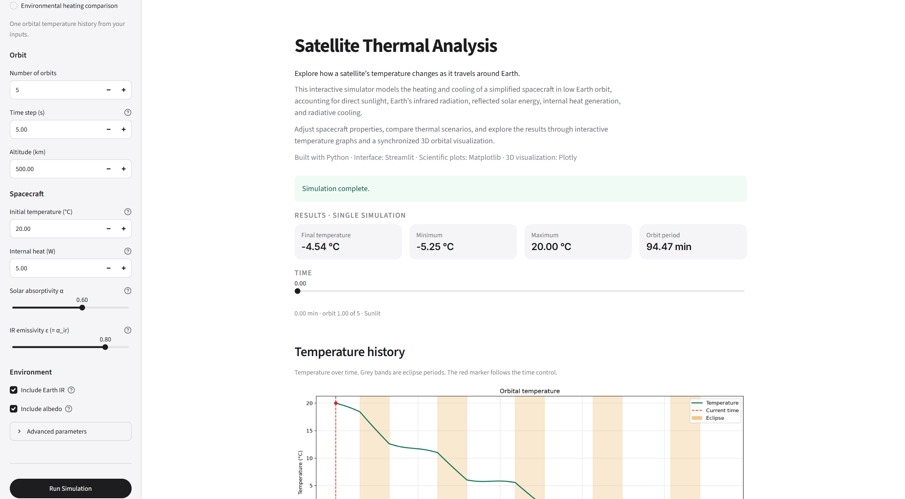
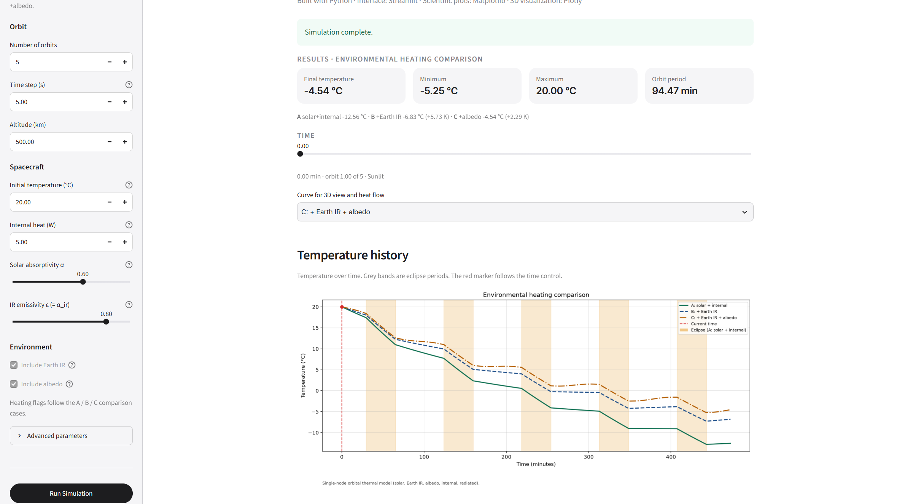
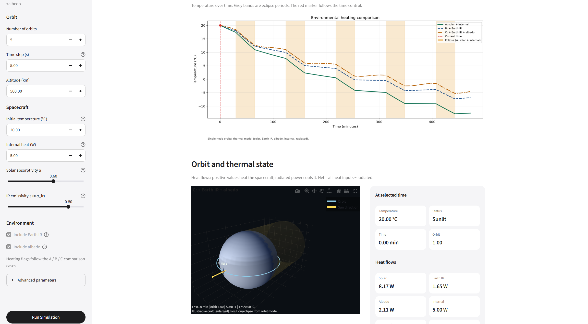

# Satellite Thermal Analysis

Single-node thermal analysis of a spacecraft in low Earth orbit (LEO), with a
Streamlit GUI for interactive exploration.

## Live application

Use the simulator in a browser (no Python install):

**https://satellite-thermal-analysis.streamlit.app**

Hosted on Streamlit Community Cloud. Defaults are ready — click **Run Simulation**.

To run on your own machine instead:

## Run locally

```bash
python -m pip install -r requirements.txt
python -m streamlit run app.py
```

Defaults are ready in the sidebar — click **Run Simulation** for a first look.







---

## 1. What does this program calculate?

It integrates the temperature of **one lumped thermal node** through one or more
circular LEO orbits, including:

- direct solar heating (off in eclipse)
- Earth infrared (planetshine)
- Earth albedo (off in eclipse)
- constant internal dissipation
- radiative cooling to space

It can also compare a modified case to the default reference case, or compare
three heating stacks (solar+internal → +Earth IR → +albedo).

---

## 2. What engineering equations does it use?

```text
m · cp · dT/dt = Q_solar + Q_earth_ir + Q_albedo + Q_internal − Q_radiated
```

with

```text
Q_solar     = α · A_projected · S          (S = 0 in eclipse)
Q_earth_ir  = α_ir · A_earth · F_earth · E_olr
Q_albedo    = α · A_albedo · F_earth · max(cos θ, 0) · a · S
Q_radiated  = ε · σ · A_radiating · T⁴
α_ir        = ε   (Kirchhoff pairing in this model)
```

Orbit period uses a circular Keplerian formula. Eclipse uses a cylindrical
Earth-shadow test with selectable orbital beta angle (default β = 0° preserves
the Version 1.0 reference). An optional **enhanced** thermal mode replaces the
fixed solar projected area with six bus-face contributions under a prescribed
attitude; legacy fixed-area mode remains the default. Internal heat may be
constant (Version 1.0 default) or follow illustrative time-dependent schedules
(eclipse-reduced, periodic high-power, or custom intervals). Optional
**Nominal / Hot / Cold** screening presets adjust environmental fluxes, beta,
and constant internal power using a documented NASA GD-AP-2301 pairing for
Hot/Cold (Nominal keeps Version 1.0 educational defaults). Time integration is
**explicit Euler**.

Full detail: [`docs/MODEL.md`](docs/MODEL.md).

---

## 3. What can the user change?

| Group | Examples |
| --- | --- |
| Orbit / numerics | altitude, beta angle, orbit count, time step |
| Thermal scenario | Nominal, Hot screening, Cold screening, or Custom |
| Spacecraft configuration | Legacy V1 areas, 0.1 m cube, CDS-inspired 1U/3U, or Custom |
| Model | legacy fixed areas or enhanced face solar + attitude |
| Attitude (enhanced) | fixed inertial, nadir-pointing, Sun-pointing |
| Body (enhanced) | length / width / height (from configuration or Custom) |
| Internal power | constant or scheduled (standby / nominal / high illustrative levels) |
| Thermal mass | mass, specific heat, initial temperature |
| Optics | solar absorptivity α, IR emissivity ε |
| Areas | projected, radiating, Earth-facing, albedo areas (legacy / planetary) |
| Environment | solar flux, Earth OLR, Bond albedo, Earth IR / albedo flags |
| Modes | single run, reference comparison, environmental heating stack, Hot/Nominal/Cold compare |

---

## 4. What does the GUI display?

- Summary temperature metrics
- Temperature history (eclipse shading)
- Synchronized 3D orbit view (illustrative spacecraft body)
- Instantaneous heat-flow values and chart
- Comparison tables and export (CSV / PNG)

Temperature plot, 3D position, and heat-flow panel follow the same time slider.
Editing sidebar inputs does **not** auto-rerun; results update only when you
click **Run simulation**.

---

## 5. Install and run

See **Run locally** above. Optional CLI studies (from the repository root):

```bash
python scripts/run_phase1.py
python scripts/run_phase2.py
python scripts/run_phase3a.py
python scripts/run_phase3b.py
python scripts/run_phase4.py
python scripts/verify_phase1.py
python scripts/verify_phase3b_convergence.py
```

---

## 6. How were the numerical methods checked?

```bash
python -m unittest discover -s tests -v
```

Checks include:

- analytical equilibrium for continuous sunlight
- eclipse geometry / duration consistency
- Earth IR and albedo heating identities
- GUI mode packaging and 3D position sync helpers
- orbital time-step convergence for the default LEO case with Earth IR + albedo

This is **numerical / equation consistency verification**, not experimental
validation against flight hardware.

---

## 7. Model limitations

- One isothermal node (no multi-node conduction network)
- Effective areas are inputs, not CAD geometry
- Emission is to a 0 K sink; Earth IR / albedo are added as separate loads
- Cylindrical shadow with variable beta (affects eclipse timing)
- Legacy mode: fixed projected area; enhanced mode: face-based solar with
  prescribed attitudes (not closed-loop ACS)
- Earth IR / albedo remain effective-area loads; 3D wing panels are visual-only
- 3D craft is illustrative and enlarged for visibility
- Not flight software; not endorsed by NASA, ESA, or any manufacturer

---

## 8. Where to read more

| Document | Contents |
| --- | --- |
| [`docs/MODEL.md`](docs/MODEL.md) | Equations, assumptions, phase history, verification numbers |
| [`docs/SOURCE_TRACEABILITY.md`](docs/SOURCE_TRACEABILITY.md) | Parameter / equation source register |
| [`docs/REFERENCES.md`](docs/REFERENCES.md) | Public engineering references and claim boundaries |
| [`docs/DEVELOPMENT.md`](docs/DEVELOPMENT.md) | Repository conventions and AI-assisted development notes |

---

## Repository layout

```text
app.py                 Streamlit GUI
satellite_thermal/     Physics, orbit, plots, GUI helpers
tests/                 Unit tests
scripts/               CLI runners and verification scripts
docs/                  Technical documentation and example figures
outputs/               Generated CLI plots (mostly gitignored)
.github/workflows/     CI tests
```

## License

MIT — see [`LICENSE`](LICENSE).
