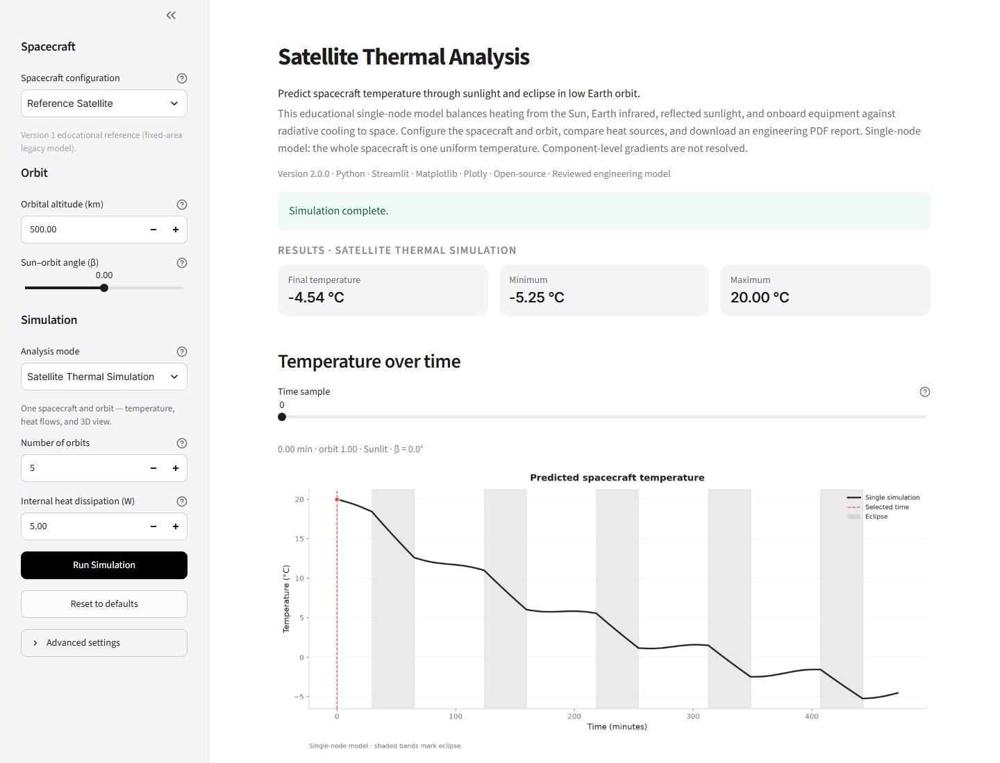
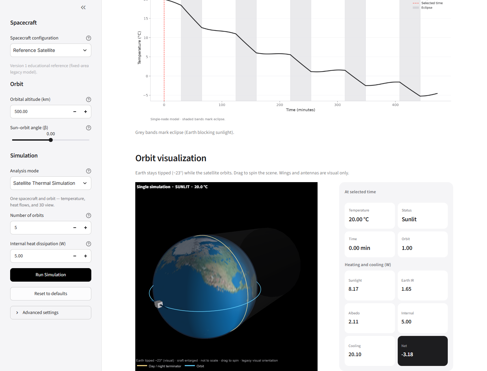

# Satellite Thermal Analysis

Single-node thermal analysis of a spacecraft in low Earth orbit (LEO), with an
interactive Streamlit simulator and downloadable PDF engineering reports.

**Version 2.0** — educational engineering software with verified numerics.
Not flight-qualified thermal analysis.

## Live application

**https://satellite-thermal-analysis.streamlit.app**

Hosted on Streamlit Community Cloud. For the latest branch locally:

```bash
python -m pip install -r requirements.txt
python -m streamlit run app.py
```

Defaults are ready in the sidebar — click **Run Simulation**.



---

## What it does

The simulator answers: how does a satellite’s temperature change in LEO, and how
do heat sources and spacecraft properties influence that temperature?

It models:

- Direct sunlight (zero during orbital eclipse)
- Earth infrared radiation
- Reflected sunlight (albedo)
- Constant internal equipment heating
- Cooling by thermal radiation to space

The whole spacecraft is a **single-node** uniform temperature. Explore Reference
Satellite / CubeSat presets, compare environmental heat sources, and download
an engineering PDF for the completed run.



---

## Analysis modes

| Mode | Purpose |
| --- | --- |
| Satellite Thermal Simulation | One configured run (default) |
| Compare Heat Sources | Same spacecraft under sunlight only, +Earth IR, then +albedo (constant internal heating in all cases) |


---

## Physical model (summary)

```text
m · cp · dT/dt = Q_solar + Q_earth_ir + Q_albedo + Q_internal − Q_radiated
```

- **Legacy** path: fixed projected and radiating areas (Version 1 reference).
- **Enhanced** path: face-based solar heating on a rectangular bus with
  **fixed inertial** orientation; Earth IR and albedo stay effective-area loads.
- Time integration: explicit Euler.

Full equations: [`docs/MODEL.md`](docs/MODEL.md).

---

## PDF engineering report

After a successful run, open **Export → Prepare Engineering Report (PDF)**.
The report uses the **completed simulation** (frozen inputs) and includes
temperature history, heat flows, orbital snapshot (with Chromium/Kaleido
fallback), assumptions, and references. See
[`docs/PDF_REPORT.md`](docs/PDF_REPORT.md).


---

## Install, run, and test

```bash
python -m pip install -r requirements.txt
python -m streamlit run app.py
python -m unittest discover -s tests -v
```

Optional CLI studies (repository root):

```bash
python scripts/run_phase1.py
```

---

## Documentation

| Doc | Contents |
| --- | --- |
| [`docs/MODEL.md`](docs/MODEL.md) | Governing equations and assumptions |
| [`docs/VERIFICATION.md`](docs/VERIFICATION.md) | Numerical checks and V1 baselines |
| [`docs/REFERENCES.md`](docs/REFERENCES.md) | Source bibliography |
| [`docs/PDF_REPORT.md`](docs/PDF_REPORT.md) | PDF contents and hosting notes |
| [`docs/SOURCE_TRACEABILITY.md`](docs/SOURCE_TRACEABILITY.md) | Parameter classifications |

---

## Development notes

Developed with AI-assisted tooling (Cursor) under human engineering review.
Git-tracked open-source educational project.

See [`docs/DEVELOPMENT.md`](docs/DEVELOPMENT.md) for contributor workflow.
